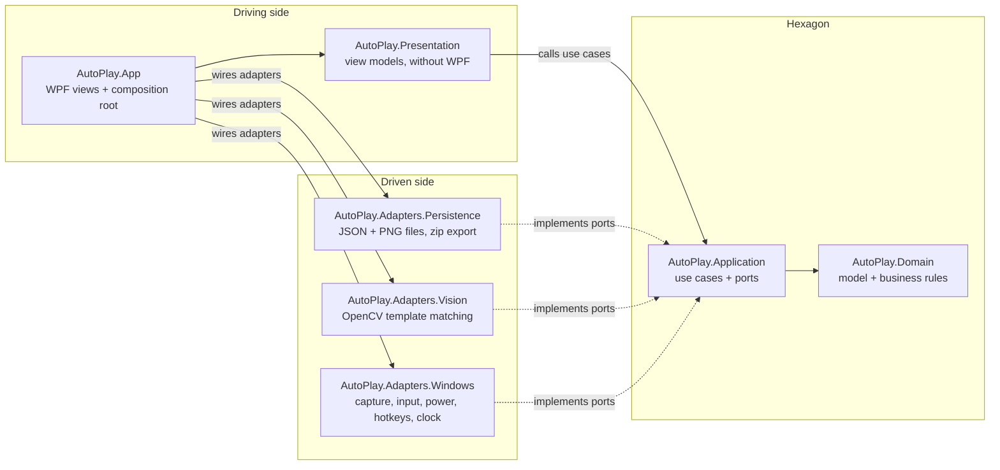

# AutoPlay — Architecture

AutoPlay follows a **hexagonal architecture** (ports and adapters). The business logic sits at the
center and depends on nothing technical; the user interface, the file system, OpenCV and Win32 are
plugged in from the outside through interfaces called **ports**.

## Layers

| Project | Role | May depend on |
|---|---|---|
| `AutoPlay.Domain` | Entities and value objects (`Profile`, `Screen`, `Location`, `Sequence`, `SequenceSchedule`, `PendingCapture`, geometry, `RawImage`) and pure business rules (coordinate scaling, rectangle editing, screen and sequence validation, sequence expansion, image scaling). | Nothing (base library only). |
| `AutoPlay.Application` | **Use cases** (`UseCases/`), the sequence engine (`Execution/SequenceRunner`), the application settings (`Settings/`) and the **driven ports** (`Ports/`) they need. | Domain, and `Microsoft.Extensions.Logging.Abstractions` for logging. |
| `AutoPlay.Adapters.Persistence` | Implements the persistence ports with JSON and PNG files, in a versioned format described by the JSON Schemas of `docs/schemas`, and the zip export; translates I/O errors into `PersistenceException`. | Application (and OpenCvSharp for PNG). |
| `AutoPlay.Adapters.Vision` | Implements `ITemplateMatcher` with OpenCV (grayscale matching, optional Lab color comparison). | Application (and OpenCvSharp). |
| `AutoPlay.Adapters.Windows` | Implements `IScreenCapture` (GDI), `IInputDriver` (`SendInput`), `IPowerManager` (power requests) and `IClock`; also provides the global hotkey and window geometry helpers used by the UI. | Application. |
| `AutoPlay.Presentation` | **Driving side, without WPF**: the view models (CommunityToolkit.Mvvm), the run scheduler, and the interfaces of the UI services the views implement (dialogs, shell, flows that open windows). It targets `net10.0`, so it is unit tested on any OS. | Application, and CommunityToolkit.Mvvm. |
| `AutoPlay.App` | **Driving adapter**: WPF views, converters and the implementations of the UI services (message boxes, flows chaining windows, hotkeys). Also the **composition root** (`App.xaml.cs`), the only place that knows the concrete adapters, and the logging configuration (Serilog). | Everything. |

## Ports

**Driving ports** — what the UI can ask the application to do (`AutoPlay.Application/UseCases` and
`Settings`):

| Use case class | Responsibilities |
|---|---|
| `ProfileService` | List, create (name rules), export and delete profiles; edit their defaults; remember the last target region. |
| `ScreenService` | Capture a target region, re-capture a screen (re-positioning its locations), save a screen (validation, template cropping), test a location on the live screen, list the sequences using a screen, delete, read captures, thumbnails and templates. |
| `SequenceService` | Save a sequence (validation against screens and other sequences, chaining rules), duplicate, set its schedule, list its callers, delete, list. |
| `SequenceExecutionService` | Prepare a run (expansion, checks and template loading), save the capture of a failed verification, record and read the last run of each sequence. |
| `ScheduleService` | Find the scheduled runs due between two times. |
| `CaptureInboxService` | Quick capture of the last target region, list, read and discard the pending captures. |
| `SequenceRunner` | Execute a sequence on a background thread (delays, waits, verification, clicks, pause, stop, resume), reporting progress through `IProgress`. |
| `SettingsService` | Read and save the application settings, with validation; raises `Changed`. |

Use cases return an `OperationResult` when a request can be refused (validation or storage error), so
the UI only has to display the messages.

**Driven ports** — what the application needs from the outside world (`AutoPlay.Application/Ports`):

| Port | Adapter |
|---|---|
| `IProfileRepository`, `IScreenRepository`, `ISequenceRepository`, `IRunLogStore`, `IRunHistory`, `ICaptureInbox`, `IProfileArchive` | `FileProfileStore` (Persistence) |
| `ISettingsStore` | `JsonSettingsStore` (Persistence) |
| `ITemplateMatcher` | `OpenCvTemplateMatcher` (Vision) |
| `IScreenCapture` | `GdiScreenCapture` (Windows) |
| `IInputDriver` | `SendInputDriver` (Windows) |
| `IPowerManager` | `WindowsPowerManager` (Windows) |
| `IClock` | `SystemClock` (Windows) |

Adapters report storage failures as `PersistenceException`, defined next to the ports, so the
application never depends on file-system, JSON or image exceptions.

Logging goes through `ILogger<T>` (Microsoft.Extensions.Logging abstractions, with source-generated
log methods); the App plugs Serilog behind it. Use cases accept a null logger, so tests need none.

## Dependency rules

1. The Domain depends on nothing.
2. The Application depends only on the Domain; its only package is the logging abstractions.
3. An adapter depends on the Application (and the Domain), never on another adapter or on the App.
4. The Presentation depends only on the Application and the MVVM toolkit: no WPF, no adapter.
5. Only the App references the adapters, to wire them in the composition root.

These rules are enforced by `tests/AutoPlay.ArchitectureTests`, which checks the project references
of every project and the assemblies actually used by the cross-platform ones. A change that breaks a
rule makes the build fail in CI.

## Tests

| Project | Scope |
|---|---|
| `AutoPlay.Domain.Tests` | Business rules, without any fake. |
| `AutoPlay.Application.Tests` | Use cases, settings and sequence engine, with in-memory fakes of the ports. |
| `AutoPlay.Adapters.Persistence.Tests` | File store, PNG codec, zip export and file format: written files validated against the JSON Schemas, older and newer format versions. |
| `AutoPlay.Adapters.Vision.Tests` | Template matching, including colors, on synthetic images. |
| `AutoPlay.Presentation.Tests` | View models and the run scheduler, with fakes of the use case ports and of the UI services. |
| `AutoPlay.ArchitectureTests` | Dependency rules. |
| `AutoPlay.TestDoubles` | Not a test project: the fakes of the ports (in-memory repository, screen capture, input, matcher, clock, logger) shared by the test projects. |

The Windows adapters and the WPF views are not covered by automated tests: they need a Windows
desktop session and are checked manually. Keeping the logic in the view models keeps that part thin.

## Adding a feature

- **New business rule** → Domain, with a test in `AutoPlay.Domain.Tests`.
- **New user action** → a method on a use case (or a new use case class) in Application, with a test
  using the fakes; then call it from a view model in Presentation, with a test, and bind it in a view.
- **New window or dialog** → a view model in Presentation; if a view model must open it, declare a
  flow interface in `Presentation/Services` and implement it in the App.
- **New external dependency** (e.g. a browser driver) → declare a port in `Application/Ports`, add an
  adapter project `AutoPlay.Adapters.<Name>` that references only the Application, and register it in
  `App.xaml.cs`.
